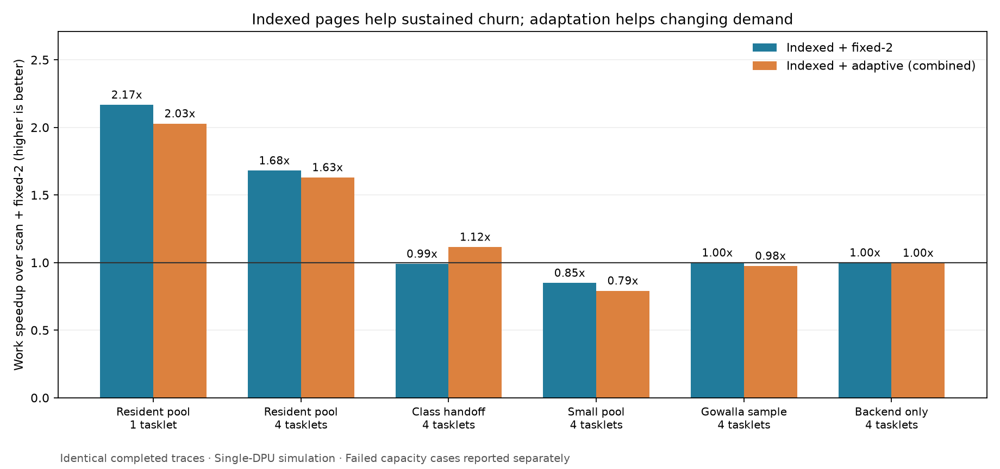

# Combined allocator: measured outcome

Implemented adaptive empty-page retention with partial/full/empty page lists and direct MRAM ownership lookup. The scan control includes the maintained allocator unchanged; fixed and adaptive share the same four-empty-page budget per tasklet. Original Figure 15 results and earlier experiments are preserved.

The best workload is a persistent object pool with scattered replacement across many pages. Changing size-class demand is the useful workload for adaptation itself. Small pools and this small graph sample do not justify enabling the extra mechanisms for speed.

## Representative measurements

All rows below compare the same completed offered work against **scan + fixed-2**. The detailed main report also includes fixed-1 and immediate-return controls.

| Workload | Scan fixed-2 work (ms) | Indexed adaptive work (ms) | Work speedup | Total speedup |
| --- | ---: | ---: | ---: | ---: |
| Resident pool, 1 tasklet | 151.10 | 74.50 | 2.028x | 1.834x |
| Resident pool, 4 tasklets | 198.28 | 121.64 | 1.630x | 1.479x |
| Class handoff, 4 tasklets | 112.69 | 101.04 | 1.115x | 1.120x |
| Small pool, 4 tasklets | 1.84 | 2.33 | 0.792x | 0.769x |
| Gowalla sample, 4 tasklets | 24.86 | 25.49 | 0.975x | 0.980x |
| Backend only, 4 tasklets | 67.84 | 68.02 | 0.997x | 0.994x |

**Values below 1 are regressions.** Total includes initialization and final drain; for the resident pool it also includes preload and destruction. Graph work includes its payload traversals/checks and excludes preload/teardown. These are simulated single-DPU measurements at 350 MHz, not hardware throughput.



## Which workloads to use

- **Persistent pool / scattered replacement:** 512 live 256 B objects per tasklet; replace half per round for 12 rounds. This preserves a substantial live set, creates reusable holes throughout many pages, and avoids repeated complete teardown during work. It is a synthetic model of an object store or graph block pool, not a captured application trace.
- **Class handoff:** six bursts of 32 objects in each of the 256 B, 1024 B, 64 B, and 512 B classes. Cold classes compete with newly hot classes for the same retention budget. Compare indexed adaptive directly with indexed fixed-2 to isolate adaptation.
- **Pressure as a capacity experiment:** report success/failure and retained memory, rather than ranking incomplete runs by runtime. The single-tasklet case demonstrates reclamation; the concurrent near-full-heap case exposes the current owner-local limit.
- **Keep small pools, backend-only requests, and the Gowalla sample as controls.** They expose metadata/controller overhead and keep the conclusions appropriately narrow.

## Isolating the mechanisms

Resident pool, one tasklet, fixed-2 retention throughout:

| Page management | Work (ms) | Speedup over scans |
| --- | ---: | ---: |
| scan | 151.10 | 1.000x |
| lists | 74.26 | 2.035x |
| lookup | 140.41 | 1.076x |
| indexed | 69.72 | 2.167x |

The partial-page lists deliver most of the persistent-pool gain. Direct lookup improves the combined static configuration further. Adaptive retention adds overhead on a stable pool; indexed fixed retention is the faster choice for that workload.

For class handoff at four tasklets, indexed adaptive takes 101.04 ms versus 113.76 ms for indexed fixed-2 (1.126x), with 344 rather than 400 refills. This comparison isolates the benefit of retention adaptation.

## Capacity outcomes and limitation

Pressure uses 16 objects per burst, three rounds per class, and a 64 KiB payload heap per active tasklet. Fixed/adaptive retain at most four empty pages per tasklet. All offered requests and all allocation failures are counted.

| Tasklets | Indexed policy | Outcome | Failed requests |
| ---: | --- | --- | ---: |
| 1 | lazy | completed | 0 |
| 1 | fixed-1 | oom | 6 |
| 1 | fixed-2 | oom | 12 |
| 1 | adaptive | completed | 0 |
| 4 | lazy | completed | 0 |
| 4 | fixed-1 | oom | 24 |
| 4 | fixed-2 | oom | 48 |
| 4 | adaptive | oom | 8 |

At four tasklets the adaptive allocator still fails near capacity. It only drains its own empty pages, and periodic maintenance cannot reclaim another inactive tasklet’s retained pages. Indexed lookup does not solve that ownership/synchronization problem. No speedup is claimed for those failed runs.

## Held-out checks

Allocator settings were frozen before testing seeds **9173 and 24107**. Held-out pools use 256 objects and eight replacement rounds; handoff uses four bursts per class; graph inputs are independently reservoir-sampled with those seeds. This checks additional orderings and samples, not statistical timing noise in the deterministic simulator.

- resident: 1.360x–1.927x work speedup over the tested fixed-2 scan control.
- handoff: 1.025x–1.088x work speedup over the tested fixed-2 scan control.
- graph: 0.975x–1.024x work speedup over the tested fixed-2 scan control.

No retention threshold was tuned to these results. The larger pool and resident lifecycle were chosen explicitly to test the page-count and reuse hypothesis; all negative controls are included in the main report.

## Cost and verification

The dense ownership table costs **64 KiB MRAM for a 32 MiB payload heap**, or 8 B per 4096 B payload page. Its initialization and updates are timed. Comparisons keep payload capacity equal and report the additional metadata separately; this is extra physical MRAM consumption. The list heads/patterns add 24 B WRAM per tasklet/class, or 3072 B at 16 tasklets.

Verified **170 declared performance configurations**, including failures, with exact generated-source hash checks; **16 native sanitizer/property combinations**; and **27 simulator validation cases**, including 16-tasklet concurrency, resident pools, and allocation failure before any free. Payloads, non-overlap, page states, ownership, large-block free, OOM recovery, and complete coalescing are covered. Maximum reported WRAM heap endpoint: 47308 / 65536. Inherited IRAM and worst-case stack-depth checks remain outside this simulator validation.

## Reproduce

```bash
python3 pim-reproduction/combined/test.py
python3 pim-reproduction/combined/sweep.py --preset main --tag combined-v2 --jobs 2
python3 pim-reproduction/combined/sweep.py --preset resident --tag resident-v2 --jobs 2
python3 pim-reproduction/combined/sweep.py --preset heldout --tag heldout-v2 --jobs 2
pim-reproduction/.venv/bin/python pim-reproduction/combined/analyze.py --tag combined-v2
pim-reproduction/.venv/bin/python pim-reproduction/combined/analyze.py --tag resident-v2
pim-reproduction/.venv/bin/python pim-reproduction/combined/analyze.py --tag heldout-v2
pim-reproduction/.venv/bin/python pim-reproduction/combined/summarize.py
```

Detailed tables, p99 latencies, memory accounting, exact sources, binary hashes, event CSVs, and declared matrices are retained under `analysis/` and `results/`. See [README](README.md) for all modes, workload definitions, and validation commands.
