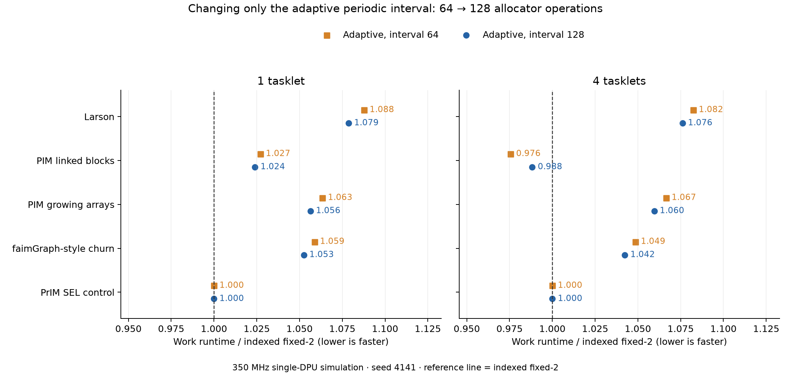

# Adaptive interval 64 versus 128

This paired experiment changes only `DECAY_OPS` from 64 to 128. It preserves traces, allocator geometry, retention caps/budget and pressure threshold. The original 64-operation results remain unchanged. Check intervals count **allocations plus frees per tasklet**, not allocations alone and not memory accesses.

**Measured outcome:** on the main seed, most allocation workloads reduce work runtime by 0.30–0.83%; four-tasklet linked-block insertion is 1.30% slower and SEL is unchanged. The second seed shows 0.44–0.60% reductions for Larson/churn. Indexed fixed-2 remains faster than adaptive 128 on Larson and churn. Total time is not uniformly improved: main-seed four-tasklet Larson and churn regress by 0.09% and 0.13%, respectively.

DRAM byte totals and backend refill counts are unchanged for most pairs. Main-seed Larson records four more read/write commands and 32 more bytes at each tasklet count, with unchanged refills. Second-seed four-tasklet Larson saves 3,504 bytes and one refill; the remaining pairs have unchanged DRAM counters. The small timing reductions are consistent with fewer controller instructions; traffic volume alone does not explain them. The periodic sweep mostly examines WRAM metadata when no empty pages need trimming.

A counter/branch still runs on every allocator call. The eight-class periodic sweep runs less often. Idle targets also decay more slowly in terms of operations; changing this parameter changes policy behavior as well as overhead.

## Work runtime

Positive reduction means 128 is faster than 64. These are paired deterministic simulator measurements at 350 MHz. Fixed uses indexed fixed-2 in every row.

| Workload | Tasklets | Seed | Fixed-2 ms | Adaptive 64 ms | Adaptive 128 ms | Runtime reduction 64→128 | 128 runtime vs fixed |
| --- | ---: | ---: | ---: | ---: | ---: | ---: | ---: |
| Larson worker | 1 | 4141 | 38.759 | 42.161 | 41.811 | +0.83% | +7.87% |
| Larson worker | 4 | 4141 | 39.878 | 43.163 | 42.911 | +0.58% | +7.61% |
| PIM-malloc linked blocks | 1 | 4141 | 44.060 | 45.254 | 45.118 | +0.30% | +2.40% |
| PIM-malloc linked blocks | 4 | 4141 | 19.192 | 18.724 | 18.967 | -1.30% | -1.17% |
| PIM-malloc growing arrays | 1 | 4141 | 19.626 | 20.870 | 20.733 | +0.66% | +5.64% |
| PIM-malloc growing arrays | 4 | 4141 | 5.864 | 6.254 | 6.213 | +0.65% | +5.96% |
| faimGraph-style updates | 1 | 4141 | 89.790 | 95.066 | 94.508 | +0.59% | +5.26% |
| faimGraph-style updates | 4 | 4141 | 24.961 | 26.172 | 26.019 | +0.58% | +4.24% |
| PrIM SEL control | 1 | 4141 | 39.250 | 39.250 | 39.250 | +0.00% | +0.00% |
| PrIM SEL control | 4 | 4141 | 14.180 | 14.180 | 14.180 | +0.00% | +0.00% |
| Larson worker | 1 | 9173 | 37.669 | 40.694 | 40.451 | +0.60% | +7.38% |
| Larson worker | 4 | 9173 | 39.957 | 42.410 | 42.202 | +0.49% | +5.62% |
| faimGraph-style updates | 1 | 9173 | 89.912 | 95.263 | 94.695 | +0.60% | +5.32% |
| faimGraph-style updates | 4 | 9173 | 24.729 | 25.964 | 25.850 | +0.44% | +4.54% |



## Total runtime

Includes initialization, preload/warmup, work, output checks and drain; excludes compilation, host transfers and simulation wall time.

| Workload | Tasklets | Seed | Fixed-2 ms | Adaptive 64 ms | Adaptive 128 ms | Runtime reduction 64→128 |
| --- | ---: | ---: | ---: | ---: | ---: | ---: |
| Larson worker | 1 | 4141 | 120.217 | 128.412 | 127.870 | +0.42% |
| Larson worker | 4 | 4141 | 208.604 | 216.637 | 216.839 | -0.09% |
| PIM-malloc linked blocks | 1 | 4141 | 238.655 | 247.116 | 246.232 | +0.36% |
| PIM-malloc linked blocks | 4 | 4141 | 111.849 | 112.946 | 112.341 | +0.54% |
| PIM-malloc growing arrays | 1 | 4141 | 126.830 | 135.370 | 134.486 | +0.65% |
| PIM-malloc growing arrays | 4 | 4141 | 40.865 | 42.707 | 42.464 | +0.57% |
| faimGraph-style updates | 1 | 4141 | 328.511 | 342.248 | 340.805 | +0.42% |
| faimGraph-style updates | 4 | 4141 | 136.326 | 137.874 | 138.047 | -0.13% |
| PrIM SEL control | 1 | 4141 | 198.422 | 198.422 | 198.422 | +0.00% |
| PrIM SEL control | 4 | 4141 | 114.140 | 114.140 | 114.140 | +0.00% |
| Larson worker | 1 | 9173 | 118.099 | 124.940 | 124.400 | +0.43% |
| Larson worker | 4 | 9173 | 209.916 | 215.358 | 214.015 | +0.62% |
| faimGraph-style updates | 1 | 9173 | 331.081 | 345.069 | 343.616 | +0.42% |
| faimGraph-style updates | 4 | 9173 | 137.543 | 140.323 | 139.895 | +0.30% |

## Memory access counts

**Scope:** read + write commands counted at the simulator DRAM row buffer over the full DPU execution, including final correctness checks. These are not C-level `mram_read` calls or all CPU memory instructions. A 256 B DMA normally splits into 32 commands at the configured 8 B granularity; row boundaries/tails can create smaller commands. Row activation and precharge are reported separately in the CSV. WRAM accesses, instruction fetches and host transfers are excluded.

| Workload | Tasklets | Fixed-2 reads+writes | Adaptive 64 reads+writes | Adaptive 128 reads+writes |
| --- | ---: | ---: | ---: | ---: |
| Larson worker | 1 | 198,012 | 200,230 | 200,234 |
| Larson worker | 4 | 758,316 | 760,500 | 760,504 |
| PIM-malloc linked blocks | 1 | 696,492 | 696,482 | 696,482 |
| PIM-malloc linked blocks | 4 | 696,210 | 696,210 | 696,210 |
| PIM-malloc growing arrays | 1 | 191,291 | 191,283 | 191,283 |
| PIM-malloc growing arrays | 4 | 193,379 | 193,385 | 193,385 |
| faimGraph-style updates | 1 | 1,224,273 | 1,224,199 | 1,224,199 |
| faimGraph-style updates | 4 | 1,223,601 | 1,223,601 | 1,223,601 |
| PrIM SEL control | 1 | 256,049 | 256,049 | 256,049 |
| PrIM SEL control | 4 | 256,049 | 256,049 | 256,049 |
| **Sum of all five workloads** | **1** | **2,566,117** | **2,568,243** | **2,568,247** |
| **Sum of all five workloads** | **4** | **3,127,555** | **3,129,745** | **3,129,749** |

Counts can differ slightly while total bytes stay identical because DMA alignment/row boundaries split commands differently. Byte counts and instructions for all 74 old/new performance configurations are retained in [memory-accesses.csv](analysis/memory-accesses.csv), including both scan controls and the ablations.

## Why fixed-2 is not a two-page live cache

`KEEP_PAGES=2` caps **completely empty** pages retained per size class. Live and partially occupied pages remain available without that two-page cap. There is also a shared four-empty-page budget per tasklet. When all existing slots are full, either policy obtains another 4 KiB page from the buddy backend, then serves multiple objects from that page.

A 256 B class page holds floor((4096−24)/256) = 15 objects. The 5,372-vertex churn sample initially allocates 5,372 such blocks, requiring 359 pages. Indexed fixed-2 records 359 refills over the entire execution, so its 3,397 timed allocations reuse the pages obtained during preload: **zero new backend page refills during timed work**. Fixed-2 is not bypassing the frontend after the first 30 objects.

For Larson at one tasklet, fixed-2 records 135 backend refills across 4,608 allocations (2.93%), not one backend allocation per object. See `all_refills` and `allocator_calls` in the CSV for every configuration. Requests larger than the frontend classes would bypass the small-object cache; this is separate from the retention limit.

Adaptive can help release idle-class pages or respond to pressure. Its current maximum is also two retained pages per class. The paper-derived traces mostly have steady demand and small heaps in use relative to the available 32 MiB, so fixed-2 can remain competitive. A claim that fixed-2 is poor needs a demonstrated workload/capacity result.

## Validation and reproduction

All 14 new performance configurations, five DPU fixture configurations and five native ASan/UBSan/oracle checks passed. Sources and traces are audited against the original runs; each adaptive pair differs only in the leading interval definition. No allocator source body or simulator executable changed. Periodic-check counts in the CSV are derived from per-tasklet allocator-call order and verified against call totals.

```sh
python3 pim-reproduction/paper-workloads/test.py --decay-ops 128 --mode indexed --policy adaptive --output-tag interval-128
python3 pim-reproduction/paper-workloads/sweep.py --preset interval-validation --tag validation-interval128-v1 --jobs 2
python3 pim-reproduction/paper-workloads/sweep.py --preset interval --tag interval128-v1 --jobs 4
pim-reproduction/.venv/bin/python pim-reproduction/paper-workloads/analyze_interval.py
```

- [Paired results, counts and instruction CSV](analysis/interval128-comparisons.csv)
- [Complete access counts](analysis/memory-accesses.csv)
- [Audit and counter-log hashes](analysis/interval128-audit.json)
