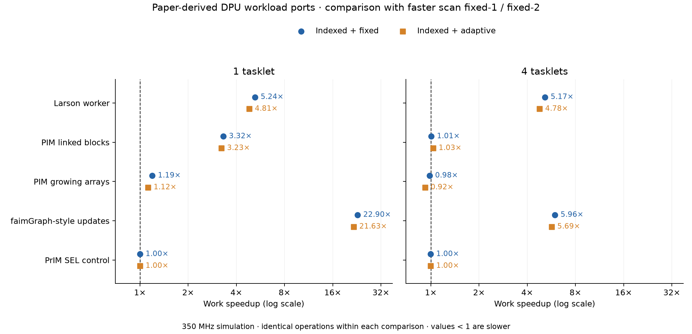

# Paper-derived workload results

All timings are simulated single-DPU milliseconds at 350 MHz. These are scaled workload ports; see [SOURCES.md](SOURCES.md) for fidelity limits. Speedups below 1 are regressions. No allocator threshold was changed for this experiment.

## Main comparison

The baseline is the **faster of scan fixed-1 and scan fixed-2**, selected separately for work and total. Fixed indexed uses keep=2. Adaptive indexed is the complete combined idea. All variants receive identical inputs and complete all offered work.

| Workload | Tasklets | Best scan work ms | Indexed fixed ms | Indexed adaptive ms | Fixed work speedup | Adaptive work speedup | Adaptive total speedup |
| --- | ---: | ---: | ---: | ---: | ---: | ---: | ---: |
| Larson worker | 1 | 202.945 | 38.759 | 42.161 | 5.236x | 4.814x | 3.536x |
| Larson worker | 4 | 206.169 | 39.878 | 43.163 | 5.170x | 4.777x | 2.472x |
| PIM-malloc linked blocks | 1 | 146.093 | 44.060 | 45.254 | 3.316x | 3.228x | 2.622x |
| PIM-malloc linked blocks | 4 | 19.330 | 19.192 | 18.724 | 1.007x | 1.032x | 1.093x |
| PIM-malloc growing arrays | 1 | 23.432 | 19.626 | 20.870 | 1.194x | 1.123x | 1.336x |
| PIM-malloc growing arrays | 4 | 5.752 | 5.864 | 6.254 | 0.981x | 0.920x | 0.972x |
| faimGraph-style updates | 1 | 2055.865 | 89.790 | 95.066 | 22.896x | 21.626x | 7.904x |
| faimGraph-style updates | 4 | 148.847 | 24.961 | 26.172 | 5.963x | 5.687x | 1.972x |
| PrIM SEL control | 1 | 39.250 | 39.250 | 39.250 | 1.000x | 1.000x | 0.999x |
| PrIM SEL control | 4 | 14.134 | 14.180 | 14.180 | 0.997x | 0.997x | 0.998x |

The strongest combined result is **21.63x work / 7.90x total** for faimGraph-style updates at 1 tasklet(s). Larson replacement and graph churn are the useful follow-up workloads: their persistent live sets expose long page scans and scattered reusable holes. The fixed-retention ablation below attributes the gain to lists and ownership lookup. Fixed indexed retention is faster than adaptive on Larson and churn; these results do not establish an additional speed benefit from adaptation on those workloads.

Work includes application operations, MRAM trace reads, payload DMA and synchronization. It excludes preload/warmup and final checking/destruction. Total includes those phases and ownership-map initialization; host transfers and simulation wall time are excluded. Larson adds a fixed pool per tasklet; graph and selection keep total input fixed. These tasklet comparisons therefore mix weak and strong scaling.

## Second seed (9173)

Settings and input sizes are unchanged. Only scan fixed-2 is tested in this matrix. This measures sensitivity to a different deterministic operation ordering and graph sample, not timing variance.

| Workload | Tasklets | Scan work ms | Indexed fixed ms | Indexed adaptive ms | Fixed speedup | Adaptive speedup | Adaptive total speedup |
| --- | ---: | ---: | ---: | ---: | ---: | ---: | ---: |
| Larson worker | 1 | 200.552 | 37.669 | 40.694 | 5.324x | 4.928x | 3.638x |
| Larson worker | 4 | 207.823 | 39.957 | 42.410 | 5.201x | 4.900x | 2.506x |
| faimGraph-style updates | 1 | 2119.233 | 89.912 | 95.263 | 23.570x | 22.246x | 8.053x |
| faimGraph-style updates | 4 | 152.555 | 24.729 | 25.964 | 6.169x | 5.876x | 1.985x |

## Mechanism ablation

One tasklet, seed 4141, fixed-2 retention in every row. This separates lists from lookup and holds the retention controller constant.

| Workload | Mode | Work ms | Speedup over scan | Timed alloc mean / p99 µs | Timed free mean / p99 µs | All-run refills |
| --- | --- | ---: | ---: | ---: | ---: | ---: |
| Larson worker | scan | 202.945 | 1.000x | 78.89 / 273.19 | 17.39 / 36.99 | 134 |
| Larson worker | lists | 69.812 | 2.907x | 8.17 / 7.91 | 23.11 / 46.81 | 135 |
| Larson worker | lookup | 166.219 | 1.221x | 73.28 / 251.66 | 5.07 / 5.23 | 134 |
| Larson worker | indexed | 38.759 | 5.236x | 8.36 / 8.13 | 7.75 / 8.15 | 135 |
| faimGraph-style updates | scan | 2055.865 | 1.000x | 540.49 / 1092.87 | 50.44 / 97.03 | 359 |
| faimGraph-style updates | lists | 236.009 | 8.711x | 5.02 / 6.19 | 50.20 / 112.57 | 359 |
| faimGraph-style updates | lookup | 1902.033 | 1.081x | 540.65 / 1093.03 | 5.00 / 5.07 | 359 |
| faimGraph-style updates | indexed | 89.790 | 22.896x | 5.49 / 6.66 | 6.68 / 8.11 | 359 |

## Memory and input accounting

All main runs have a 32 MiB payload heap. Lookup/indexed modes additionally consume 64 KiB MRAM for the owner map; this is extra physical memory. List descriptors add 24 B per tasklet/class. The table gives allocator payload high-water marks, excluding preallocated application tables/traces; those arrays are identical across variants. Sum-of-tasklet peak slot counters are not a simultaneous global peak.

| Workload | Tasklets | Scan fixed-2 payload peak KiB | Indexed fixed payload peak KiB | Indexed adaptive payload peak KiB | Timed alloc / free calls |
| --- | ---: | ---: | ---: | ---: | ---: |
| Larson worker | 1 | 504.0 | 504.0 | 504.0 | 2048 / 2048 |
| Larson worker | 4 | 1968.0 | 1968.0 | 1968.0 | 8192 / 8192 |
| PIM-malloc linked blocks | 1 | 1436.0 | 1436.0 | 1436.0 | 1687 / 0 |
| PIM-malloc linked blocks | 4 | 1440.0 | 1440.0 | 1440.0 | 1687 / 0 |
| PIM-malloc growing arrays | 1 | 352.0 | 352.0 | 352.0 | 1690 / 3 |
| PIM-malloc growing arrays | 4 | 372.0 | 372.0 | 364.0 | 1690 / 3 |
| faimGraph-style updates | 1 | 1436.0 | 1436.0 | 1436.0 | 3397 / 3397 |
| faimGraph-style updates | 4 | 1440.0 | 1440.0 | 1440.0 | 3397 / 3397 |
| PrIM SEL control | 1 | 0.0 | 0.0 | 0.0 | 0 / 0 |
| PrIM SEL control | 4 | 0.0 | 0.0 | 0.0 | 0 / 0 |

Graph inputs and actual final degree-driven allocation sizes (main seed):

- PIM-malloc linked blocks: 3072 undirected edges, 5372 vertices, maximum degree 35, 4919 degree-one vertices; 256 B adjacency blocks.
- PIM-malloc growing arrays: 3072 undirected edges, 5372 vertices, maximum degree 35, 4919 degree-one vertices; final array capacities 64, 128, 256 B (growth also traverses smaller powers of two).
- faimGraph-style updates: 3072 undirected edges, 5372 vertices, maximum degree 35, 4919 degree-one vertices; 256 B adjacency blocks.

## Verification and limits

The analyzer verified all **60 declared performance runs**, **10 DPU correctness runs** and **40 native ASan/UBSan/oracle checks**. Every performance run completed without allocation failures and ended with zero live payload, balanced calls and complete buddy coalescing. Exact generated sources, trace/dataset manifests and simulator hashes match the saved artifacts. Maximum reported WRAM heap endpoint: 40644 / 65,536 B. The separate production-size gate also passed.

Graphs have independent degree/checksum references on the DPU; native fixtures additionally enforce exact neighbor membership and uniqueness. Larson checks live byte counts and payload tags; SEL checks every output element. Native interval oracles detect live-allocation overlap and wrong-size frees. Performance runs disable extra invariant traversals inside the kernel. Workload assertions and DMA remain included.

These are deterministic simulator samples, so repeated identical runs would not provide independent statistical confidence intervals. Second-seed results test input sensitivity. Same-owner frees exclude inter-tasklet object migration; no original concurrent Larson or full GPU faimGraph claim is supported. The reduced graph does not reproduce full-dataset allocation ranges. Only SEL is ported from PrIM. Worst-case stack depth, IRAM feasibility, physical hardware and multi-DPU transfers remain outside this evaluation.

The 3,072-edge reservoir sample is sparse: most vertices have one neighbor, and the largest degree is below one 62-neighbor block. This makes deletion/reinsertion replace many individual adjacency blocks across hundreds of allocator pages. That behavior strongly exercises page discovery and ownership lookup; it does not establish the same speedup for a full, denser graph. Multi-block adjacency is checked separately by the star fixture.

Development attempts with compiler-duplicated phase labels are excluded by explicit tag selection. Final runs use dedicated phase functions and require exact probe counts as well as successful simulator exit. Earlier results are retained for audit.

## Artifacts

- [Complete timings, latencies and memory CSV](analysis/all-runs.csv)
- [Main speedup comparisons](analysis/main-comparisons.csv)
- [Second-seed comparisons](analysis/heldout-comparisons.csv)
- [Audit and exact accepted paths](analysis/audit.json)
- [Source mapping and limitations](SOURCES.md)
- [Reproduction commands](README.md)
