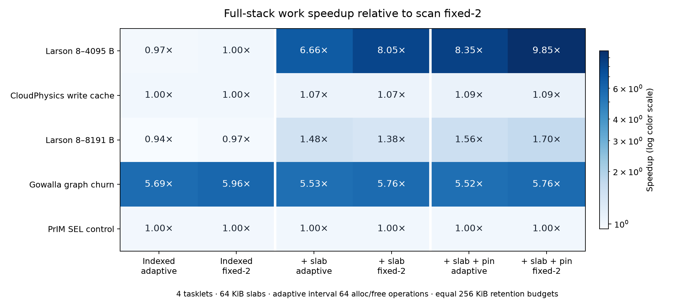
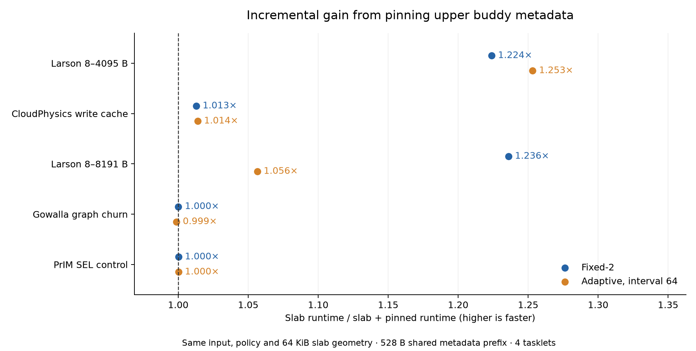

# Full allocator stack with pinned buddy metadata

All requested stages were run on five cases at **four tasklets**, using the same offered work within each case. These are deterministic 350 MHz single-DPU workload kernels/ports, not hardware or complete original applications. [README.md](README.md) defines provenance, workload changes and the WRAM/MRAM consistency design.

**Baseline:** maintained scan fixed-2, without indexing, slabs or pinning. All stages use a 32 MiB payload heap and 256 KiB empty-byte budgets/tasklet. Indexed stages add 64 KiB MRAM ownership lookup. Slabs use 64 KiB spans for 2049–4096 B objects. Every adaptive stage checks every **64 allocation plus free operations**, with maximum two retained empty spans/class. Pinning keeps the aligned 528 B upper metadata prefix in shared WRAM; lower metadata remains streamed.

Work includes application/trace DMA and synchronization, excluding warmup/preload and final checking/drain. Total includes initialization, warmup/preload, work, output checking and drain, ending before passive final accounting. Compilation, simulation wall time, storage/network service time and host transfers are excluded.

## Work runtime: every requested stage

Milliseconds; lower is faster. Abbreviations: IA/IF = indexed adaptive-64/fixed-2; SA/SF = indexed + slab with that policy; PA/PF = indexed + slab + pinned metadata with that policy.

| Workload | Baseline | IA | IF | SA | SF | PA | PF |
| --- | ---: | ---: | ---: | ---: | ---: | ---: | ---: |
| Larson 8–4095 B | 160.089 | 164.537 | 159.826 | 24.026 | 19.894 | 19.172 | 16.255 |
| CloudPhysics write cache | 122.773 | 122.925 | 122.784 | 114.586 | 114.528 | 113.023 | 113.075 |
| Larson 8–8191 B | 320.457 | 342.572 | 331.666 | 216.369 | 232.613 | 204.807 | 188.202 |
| Gowalla graph churn | 148.847 | 26.172 | 24.961 | 26.918 | 25.830 | 26.954 | 25.827 |
| PrIM SEL control | 14.134 | 14.180 | 14.180 | 14.135 | 14.135 | 14.133 | 14.133 |

## Work speedup relative to scan fixed-2

Values below 1 are regressions. This table measures the complete progression; the following incremental table isolates pinning.

| Workload | IA | IF | SA | SF | PA | PF |
| --- | ---: | ---: | ---: | ---: | ---: | ---: |
| Larson 8–4095 B | 0.973x | 1.002x | 6.663x | 8.047x | 8.350x | 9.849x |
| CloudPhysics write cache | 0.999x | 1.000x | 1.071x | 1.072x | 1.086x | 1.086x |
| Larson 8–8191 B | 0.935x | 0.966x | 1.481x | 1.378x | 1.565x | 1.703x |
| Gowalla graph churn | 5.687x | 5.963x | 5.530x | 5.762x | 5.522x | 5.763x |
| PrIM SEL control | 0.997x | 0.997x | 1.000x | 1.000x | 1.000x | 1.000x |

## Incremental gain from pinned metadata

Each comparison changes only the pinned backend and its required WRAM. Slab size, indexing, retention policy, interval, inputs and heap/budget are fixed. DRAM bytes are full-execution counts; WRAM loads/stores are not counted.

| Workload | Policy | Slab work ms | Slab + pin ms | Pin work speedup | Pin total speedup | DRAM byte reduction | Extra WRAM endpoint B |
| --- | --- | ---: | ---: | ---: | ---: | ---: | ---: |
| Larson 8–4095 B | adaptive | 24.026 | 19.172 | 1.253x | 1.258x | +48.34% | 540 |
| Larson 8–4095 B | fixed | 19.894 | 16.255 | 1.224x | 1.230x | +46.48% | 540 |
| CloudPhysics write cache | adaptive | 114.586 | 113.023 | 1.014x | 1.011x | +4.45% | 540 |
| CloudPhysics write cache | fixed | 114.528 | 113.075 | 1.013x | 1.010x | +4.44% | 540 |
| Larson 8–8191 B | adaptive | 216.369 | 204.807 | 1.056x | 1.193x | +66.92% | 540 |
| Larson 8–8191 B | fixed | 232.613 | 188.202 | 1.236x | 1.208x | +66.49% | 540 |
| Gowalla graph churn | adaptive | 26.918 | 26.954 | 0.999x | 1.169x | +9.66% | 540 |
| Gowalla graph churn | fixed | 25.830 | 25.827 | 1.000x | 1.164x | +9.66% | 540 |
| PrIM SEL control | adaptive | 14.135 | 14.133 | 1.000x | 1.000x | +0.00% | 540 |
| PrIM SEL control | fixed | 14.135 | 14.133 | 1.000x | 1.000x | +0.00% | 540 |

Pinning can only accelerate the buddy accesses that remain after frontend reuse. A slab benefit, an indexed lookup benefit and an adaptive-policy benefit are separate claims. The 8–8191 B Larson configuration includes direct-bypass requests; graph churn uses 256 B objects; selection has no allocator calls during work. These different paths are retained rather than selecting only favorable traces.

## Total runtime

| Workload | Baseline | IA | IF | SA | SF | PA | PF |
| --- | ---: | ---: | ---: | ---: | ---: | ---: | ---: |
| Larson 8–4095 B | 381.058 | 388.616 | 381.095 | 76.064 | 69.261 | 60.467 | 56.293 |
| CloudPhysics write cache | 338.749 | 339.471 | 338.902 | 323.282 | 323.199 | 319.822 | 320.012 |
| Larson 8–8191 B | 708.530 | 741.804 | 709.334 | 478.896 | 459.423 | 401.482 | 380.470 |
| Gowalla graph churn | 272.199 | 137.874 | 136.326 | 140.284 | 137.731 | 119.982 | 118.350 |
| PrIM SEL control | 113.881 | 114.140 | 114.140 | 114.124 | 114.124 | 114.124 | 114.124 |

## Full-execution memory commands and storage costs

DRAM read/write counts include final checks, exclude WRAM accesses, instruction fetches, row activation/precharge and host transfers, and are not source-level DMA-call counts. Pinning moves upper metadata traffic into WRAM; it does not eliminate all memory accesses. MRAM retains the same buddy metadata reservation/shadow. Payload peak excludes the owner map, buddy metadata and identical application tables/traces.

| Workload | Variant | DRAM reads+writes | DRAM MiB | Backend allocations | Peak payload KiB | WRAM heap endpoint B |
| --- | --- | ---: | ---: | ---: | ---: | ---: |
| Larson 8–4095 B | Scan fixed-2 | 709,446 | 5.412 | 1,416 | 996.0 | 39,868 |
| Larson 8–4095 B | Indexed adaptive-64 | 677,532 | 5.168 | 1,440 | 960.0 | 40,644 |
| Larson 8–4095 B | Indexed fixed-2 | 666,990 | 5.088 | 1,416 | 992.0 | 40,644 |
| Larson 8–4095 B | + slab, adaptive | 187,542 | 1.430 | 279 | 1204.0 | 40,868 |
| Larson 8–4095 B | + slab, fixed-2 | 177,044 | 1.350 | 255 | 1256.0 | 40,868 |
| Larson 8–4095 B | + slab + pin, adaptive | 96,908 | 0.738 | 279 | 1208.0 | 41,408 |
| Larson 8–4095 B | + slab + pin, fixed-2 | 94,810 | 0.722 | 255 | 1244.0 | 41,408 |
| CloudPhysics write cache | Scan fixed-2 | 770,556 | 5.879 | 183 | 1408.0 | 47,572 |
| CloudPhysics write cache | Indexed adaptive-64 | 778,895 | 5.942 | 183 | 1408.0 | 48,340 |
| CloudPhysics write cache | Indexed fixed-2 | 778,789 | 5.942 | 183 | 1408.0 | 48,340 |
| CloudPhysics write cache | + slab, adaptive | 735,825 | 5.614 | 95 | 1596.0 | 48,564 |
| CloudPhysics write cache | + slab, fixed-2 | 735,889 | 5.614 | 95 | 1596.0 | 48,564 |
| CloudPhysics write cache | + slab + pin, adaptive | 703,089 | 5.364 | 95 | 1596.0 | 49,104 |
| CloudPhysics write cache | + slab + pin, fixed-2 | 703,233 | 5.365 | 95 | 1596.0 | 49,104 |
| Larson 8–8191 B | Scan fixed-2 | 1,401,137 | 10.689 | 1,865 | 1624.0 | 39,868 |
| Larson 8–8191 B | Indexed adaptive-64 | 1,473,142 | 11.238 | 1,885 | 1592.0 | 40,644 |
| Larson 8–8191 B | Indexed fixed-2 | 1,390,160 | 10.605 | 1,865 | 1604.0 | 40,644 |
| Larson 8–8191 B | + slab, adaptive | 930,188 | 7.096 | 1,331 | 1900.0 | 40,868 |
| Larson 8–8191 B | + slab, fixed-2 | 879,010 | 6.705 | 1,311 | 1904.0 | 40,868 |
| Larson 8–8191 B | + slab + pin, adaptive | 307,746 | 2.347 | 1,331 | 1872.0 | 41,408 |
| Larson 8–8191 B | + slab + pin, fixed-2 | 294,648 | 2.247 | 1,311 | 1932.0 | 41,408 |
| Gowalla graph churn | Scan fixed-2 | 2,058,363 | 15.696 | 360 | 1440.0 | 39,868 |
| Gowalla graph churn | Indexed adaptive-64 | 1,223,601 | 9.335 | 360 | 1440.0 | 40,644 |
| Gowalla graph churn | Indexed fixed-2 | 1,223,601 | 9.335 | 360 | 1440.0 | 40,644 |
| Gowalla graph churn | + slab, adaptive | 1,224,589 | 9.335 | 360 | 1440.0 | 40,868 |
| Gowalla graph churn | + slab, fixed-2 | 1,224,619 | 9.335 | 360 | 1440.0 | 40,868 |
| Gowalla graph churn | + slab + pin, adaptive | 1,106,325 | 8.433 | 360 | 1440.0 | 41,408 |
| Gowalla graph churn | + slab + pin, fixed-2 | 1,105,345 | 8.433 | 360 | 1440.0 | 41,408 |
| PrIM SEL control | Scan fixed-2 | 247,857 | 1.876 | 0 | 0.0 | 39,804 |
| PrIM SEL control | Indexed adaptive-64 | 256,049 | 1.939 | 0 | 0.0 | 40,580 |
| PrIM SEL control | Indexed fixed-2 | 256,049 | 1.939 | 0 | 0.0 | 40,580 |
| PrIM SEL control | + slab, adaptive | 256,049 | 1.939 | 0 | 0.0 | 40,804 |
| PrIM SEL control | + slab, fixed-2 | 256,049 | 1.939 | 0 | 0.0 | 40,804 |
| PrIM SEL control | + slab + pin, adaptive | 256,041 | 1.939 | 0 | 0.0 | 41,344 |
| PrIM SEL control | + slab + pin, fixed-2 | 256,041 | 1.939 | 0 | 0.0 | 41,344 |

## Second seed / trace window

Only slab versus slab+pinning is repeated: Larson seed 9173 and CloudPhysics offset 4096. All other parameters remain unchanged; both retention policies are reported.

| Workload | Policy | Unpinned work ms | Pinned work ms | Pin work speedup | Pin total speedup |
| --- | --- | ---: | ---: | ---: | ---: |
| Larson 8–4095 B | adaptive | 23.965 | 19.656 | 1.219x | 1.227x |
| Larson 8–4095 B | fixed | 19.537 | 15.876 | 1.231x | 1.243x |
| CloudPhysics write cache | adaptive | 101.055 | 99.647 | 1.014x | 1.009x |
| CloudPhysics write cache | fixed | 100.964 | 99.585 | 1.014x | 1.010x |

## Validation and limits

All **43 performance configurations**, **35 DPU invariant-validation cases**, and **47 native sanitizer executables passed**. Native coverage includes six differential backend programs, each covering three heap sizes, six layered allocator programs and all 35 workload/stage combinations. Every accepted run has exact source/trace/simulator hashes, identical offered requests within its comparisons, no allocation failures, balanced calls, complete coalescing and zero final live/retained payload. The canonical backend hash is unchanged.

Maximum reported WRAM endpoint: **49,472 / 65,536 B**. The pinned metadata allocation is shared; it is not multiplied by tasklets. Endpoint checks do not establish worst-case stack depth, IRAM fit or physical hardware throughput. Deterministic runs do not supply independent confidence intervals. All workloads here use ample payload capacity; existing slab fragmentation and sparse-pinning costs remain applicable.

Native checkpoint tests compare every tree state and raw flushed metadata bytes, catching stale overlapping windows. The MRAM pinned-prefix shadow is not read by normal allocation; explicit `syncPinnedMetadata` is available to a quiescent caller. It is not required for live allocator consistency and is not invoked on every request.

- [All timings, latencies, traffic, memory and accepted run paths](analysis/all-runs.csv)
- [Incremental pinning comparisons](analysis/incremental-pinning.csv)
- [Request-size distributions](analysis/request-profiles.json)
- [Complete audit](analysis/audit.json)
- [Design and reproduction commands](README.md)
