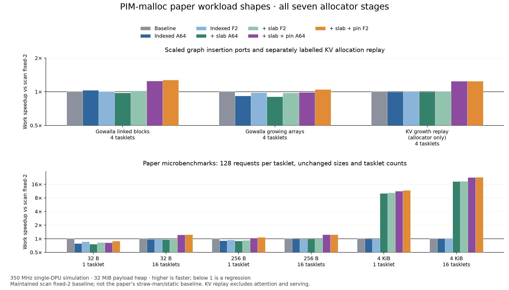

# PIM-malloc paper workload shapes on the full stack

All **63 configurations** completed: nine cases × seven variants. The graph cases are scaled kernel ports of the paper methodology; the allocation microbenchmarks retain the paper’s sizes, request count and tasklet counts. KV growth is an **allocator-only replay**, not a completed attention/LLM-serving reproduction. [README.md](README.md) gives exact scope and missing artifact components.

Every run uses the same maintained allocator stack, 32 MiB payload heap, 256 KiB empty-byte budget/tasklet and 350 MHz single-DPU simulator. Adaptive checks occur every 64 allocation plus free operations. Slabs use 64 KiB spans only for 2049–4096 B requests. Pinning uses a 528 B WRAM metadata prefix. Baseline is maintained **scan fixed-2**, not the paper’s straw-man buddy or static CSR baseline.

## Work runtime across every stage

Milliseconds, lower is faster. IA/IF: indexed adaptive-64/fixed-2. SA/SF: indexed + slab. PA/PF: indexed + slab + pinned metadata.

| Case | Tasklets | Baseline | IA | IF | SA | SF | PA | PF |
| --- | ---: | ---: | ---: | ---: | ---: | ---: | ---: | ---: |
| Gowalla linked blocks | 4 | 19.330 | 18.724 | 19.192 | 19.744 | 18.995 | 15.479 | 15.198 |
| Gowalla growing arrays | 4 | 5.752 | 6.254 | 5.864 | 6.372 | 5.894 | 5.845 | 5.494 |
| KV growth replay (allocator only) | 4 | 24.382 | 24.511 | 24.329 | 24.567 | 24.343 | 19.657 | 19.625 |
| 32 B allocation | 1 | 0.875 | 1.115 | 1.023 | 1.149 | 1.061 | 1.077 | 0.990 |
| 32 B allocation | 16 | 6.938 | 7.147 | 7.064 | 7.183 | 7.117 | 5.719 | 5.648 |
| 256 B allocation | 1 | 2.076 | 2.284 | 2.191 | 2.329 | 2.249 | 2.005 | 1.925 |
| 256 B allocation | 16 | 34.201 | 34.457 | 34.340 | 34.544 | 34.413 | 27.750 | 27.641 |
| 4 KiB allocation | 1 | 20.912 | 21.090 | 20.985 | 2.081 | 2.000 | 1.858 | 1.778 |
| 4 KiB allocation | 16 | 508.474 | 508.648 | 508.498 | 27.414 | 27.312 | 22.335 | 22.243 |

## Harness total runtime across every stage

Milliseconds, including initialization/preload, work, complete payload or graph checks, and final reclamation. For the allocation microbenchmarks this is a checked harness lifecycle, not the metric plotted in the paper; the per-call allocation latency table below is the closer methodological comparison.

| Case | Tasklets | Baseline | IA | IF | SA | SF | PA | PF |
| --- | ---: | ---: | ---: | ---: | ---: | ---: | ---: | ---: |
| Gowalla linked blocks | 4 | 123.546 | 112.946 | 111.849 | 114.304 | 112.314 | 93.550 | 92.553 |
| Gowalla growing arrays | 4 | 41.598 | 42.707 | 40.877 | 43.975 | 42.190 | 40.689 | 38.865 |
| KV growth replay (allocator only) | 4 | 73.413 | 73.604 | 73.295 | 73.308 | 73.286 | 60.715 | 60.657 |
| 32 B allocation | 1 | 2.266 | 3.006 | 2.804 | 3.127 | 2.940 | 3.022 | 2.835 |
| 32 B allocation | 16 | 13.833 | 14.973 | 14.663 | 15.244 | 14.936 | 12.836 | 12.523 |
| 256 B allocation | 1 | 7.953 | 8.576 | 8.371 | 8.709 | 8.528 | 8.183 | 8.003 |
| 256 B allocation | 16 | 65.205 | 66.015 | 65.862 | 66.284 | 65.972 | 54.975 | 54.705 |
| 4 KiB allocation | 1 | 91.803 | 92.360 | 92.143 | 61.301 | 61.120 | 60.891 | 60.710 |
| 4 KiB allocation | 16 | 930.858 | 931.546 | 931.385 | 147.588 | 147.359 | 139.036 | 137.990 |

## Full-stack speedups and incremental pinning

Full-stack work/total compare with scan fixed-2. Pin columns compare with the same policy and slabs before pinning. Values below one are regressions.

| Case | Tasklets | Adaptive work | Adaptive total | Fixed work | Fixed total | Pin adaptive work | Pin fixed work |
| --- | ---: | ---: | ---: | ---: | ---: | ---: | ---: |
| Gowalla linked blocks | 4 | 1.249× | 1.321× | 1.272× | 1.335× | 1.276× | 1.250× |
| Gowalla growing arrays | 4 | 0.984× | 1.022× | 1.047× | 1.070× | 1.090× | 1.073× |
| KV growth replay (allocator only) | 4 | 1.240× | 1.209× | 1.242× | 1.210× | 1.250× | 1.240× |
| 32 B allocation | 1 | 0.813× | 0.750× | 0.884× | 0.799× | 1.067× | 1.072× |
| 32 B allocation | 16 | 1.213× | 1.078× | 1.228× | 1.105× | 1.256× | 1.260× |
| 256 B allocation | 1 | 1.035× | 0.972× | 1.079× | 0.994× | 1.162× | 1.168× |
| 256 B allocation | 16 | 1.232× | 1.186× | 1.237× | 1.192× | 1.245× | 1.245× |
| 4 KiB allocation | 1 | 11.255× | 1.508× | 11.763× | 1.512× | 1.120× | 1.125× |
| 4 KiB allocation | 16 | 22.766× | 6.695× | 22.860× | 6.746× | 1.227× | 1.228× |

## What the comparisons show

- **4 KiB, 1 tasklet:** the full fixed stack provides 11.76× work and 1.51× harness-total speedup. Backend allocations fall from 128 to 9; pinning adds 1.13× over the same fixed slab variant. Peak payload reservation rises from 512 to 576 KiB, plus the indexed variants’ separate 64 KiB ownership map.
- **4 KiB, 16 tasklets:** the full fixed stack provides 22.86× work and 6.75× harness-total speedup. Backend allocations fall from 2,048 to 144; pinning adds 1.23× over the same fixed slab variant. Peak payload reservation rises from 8,192 to 9,216 KiB, plus the indexed variants’ separate 64 KiB ownership map.
- **Paper graph ports:** full fixed-stack work gains are 1.27× for linked blocks and 1.05× for growing arrays. The adaptive stack reaches 0.984× on growing arrays, a regression. The new slab class is unused here; pinning benefits backend refills, while indexed ownership can cost more on small insertion-only cases.
- **Small-object control:** the full fixed stack reaches only 0.884× on single-tasklet 32 B allocations. Extra list/ownership bookkeeping can outweigh savings. Allocation-only cases keep their objects live, so they do not exercise the benefit of retaining empty pages during work.

The original frontend stops at 2 KiB, so every original 4 KiB request calls buddy. The slab extension adds a ninth, 4 KiB class backed by 64 KiB spans. Its large gains here come from caching a previously uncached size. They do not demonstrate equivalent gains from enlarging pages for the existing small-object classes. Fixed-2 limits empty retention and does not cap live capacity.

## Paper microbenchmark: mean allocation latency

Microseconds per allocation, including lock wait. These per-call PC probes exclude pointer-record DMA, checking and frees; work makespan above includes pointer recording and the end barrier. Arithmetic mean of concurrent request latencies is distinct from elapsed work divided by total requests.

| Request | Tasklets | Baseline | IA | IF | SA | SF | PA | PF |
| --- | ---: | ---: | ---: | ---: | ---: | ---: | ---: | ---: |
| 32 B allocation | 1 | 6.201 | 8.077 | 7.357 | 8.337 | 7.655 | 7.777 | 7.095 |
| 32 B allocation | 16 | 43.472 | 45.028 | 44.418 | 45.294 | 44.798 | 35.977 | 35.460 |
| 256 B allocation | 1 | 15.579 | 17.209 | 16.476 | 17.558 | 16.931 | 15.025 | 14.398 |
| 256 B allocation | 16 | 256.512 | 258.492 | 257.592 | 259.164 | 258.152 | 207.975 | 207.130 |
| 4 KiB allocation | 1 | 162.736 | 164.131 | 163.307 | 15.618 | 14.991 | 13.878 | 13.251 |
| 4 KiB allocation | 16 | 3960.865 | 3962.214 | 3961.039 | 205.555 | 204.762 | 167.372 | 166.665 |

## Memory requests and traffic

Counts cover the full run, including preload, checking, reclamation and passive final accounting. They are simulator DRAM read/write commands, not every WRAM access or source-level DMA invocation. Traffic also includes application data, graph/record storage and the ownership map.

| Case | Tasklets | Alloc calls | Timed alloc calls | Baseline DRAM commands | PA commands | PF commands | Baseline DRAM bytes | PA bytes | PF bytes |
| --- | ---: | ---: | ---: | ---: | ---: | ---: | ---: | ---: | ---: |
| Gowalla linked blocks | 4 | 5,372 | 1,687 | 955,931 | 578,538 | 577,954 | 7,642,616 | 4,623,632 | 4,623,632 |
| Gowalla growing arrays | 4 | 5,377 | 1,690 | 244,122 | 160,491 | 160,579 | 1,948,400 | 1,279,320 | 1,279,960 |
| KV growth replay (allocator only) | 4 | 1,536 | 1,024 | 372,222 | 251,014 | 250,978 | 2,977,488 | 2,007,824 | 2,007,824 |
| 32 B allocation | 1 | 128 | 128 | 4,226 | 11,566 | 11,566 | 33,776 | 92,496 | 92,496 |
| 32 B allocation | 16 | 2,048 | 2,048 | 59,786 | 54,346 | 54,282 | 477,776 | 434,256 | 434,256 |
| 256 B allocation | 1 | 128 | 128 | 15,000 | 19,364 | 19,364 | 120,000 | 154,880 | 154,880 |
| 256 B allocation | 16 | 2,048 | 2,048 | 232,234 | 182,970 | 182,970 | 1,857,360 | 1,463,248 | 1,463,248 |
| 4 KiB allocation | 1 | 128 | 128 | 187,406 | 142,290 | 142,290 | 1,499,216 | 1,138,288 | 1,138,288 |
| 4 KiB allocation | 16 | 2,048 | 2,048 | 2,990,666 | 2,147,130 | 2,147,130 | 23,924,816 | 17,176,528 | 17,176,528 |

## Validation and interpretation

All 42 new native ASan/UBSan cases passed, with independent live-allocation interval checks, complete payload checks, exact graph-neighbor checks, allocator invariants and final buddy root coalescing. All 63 DPU runs passed application/count/final-state checks without allocation failures. Maximum recorded WRAM heap endpoint: **48,296 / 65,536 B**. Existing differential backend and layered tests are preserved under the parent experiment.

The accepted matrix was declared before measurements and includes every case, including regressions. Graph updates use a 3,072-edge real Gowalla sample split 1:2 new/existing; its growing arrays are smaller than the full paper dataset’s 64 B–32 KiB range. No graph requests in this sample use the new slab class. 512 B KV requests also use the existing small-object frontend. Consequently, large slab benefits should be assessed on the unchanged 4 KiB request microbenchmark, rather than by changing graph/KV object sizes.

Work excludes preload/initialization and output checking/drain. Total includes those phases and ends before passive final accounting. These measurements do not reproduce the paper’s static CSR speedups, original allocator baselines, full attention computation, tokens/s or TPOT.

The earlier five-case comparison remains available in the [parent results](../RESULTS.md); its sources and saved measurements are unchanged.

Machine-readable evidence: [all stages and traffic](analysis/all-runs.csv), [speedups](analysis/comparisons.csv), [pin-only changes](analysis/incremental-pinning.csv), [request profiles](analysis/request-profiles.json), [source/trace/simulator audit](analysis/audit.json).
