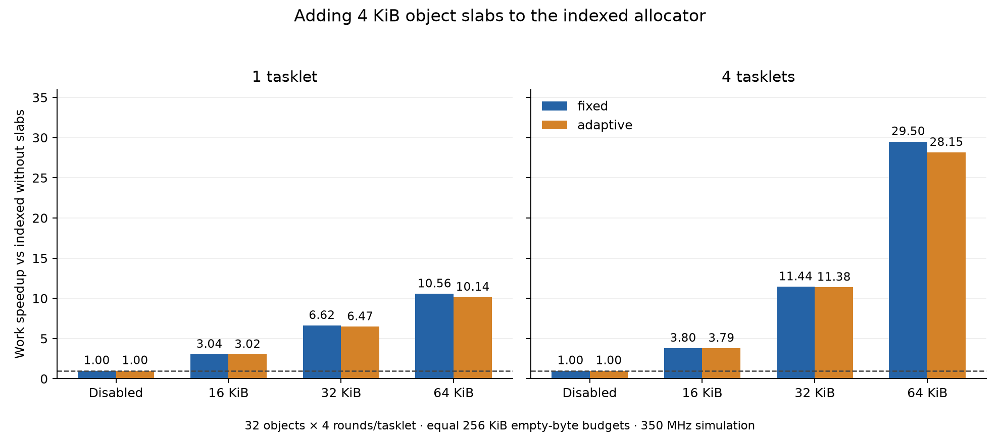

# Slabs + indexed + fixed/adaptive: results

All comparisons already use indexed lists and ownership lookup. The added mechanism is the 2049–4096 B slab class; fixed and adaptive are separate retention policies. These are synthetic 350 MHz single-DPU simulations, not full paper applications or hardware measurements.

Every row uses a 32 MiB payload heap, an additional 64 KiB MRAM owner map, and the same **256 KiB empty-byte budget per tasklet**. The adaptive interval is 128 alloc/free operations. A fixed/adaptive class target counts spans, while the budget is charged in physical bytes. This is an explicit larger byte budget than the earlier 16 KiB experiment; only like-budget controls below are used for ratios.

## Dense 4 KiB bursts

Each tasklet allocates and frees 32 objects for four rounds. Speedup is relative to **indexed without slabs using the same retention policy**. Values below 1 are regressions. All offered requests succeed.

| Slab KiB | Policy | Tasklets | Work ms | Work speedup | Total speedup | Backend allocations | Peak payload KiB | End empty KiB |
| ---: | --- | ---: | ---: | ---: | ---: | ---: | ---: | ---: |
| 0 | fixed | 1 | 34.894 | 1.000x | 1.000x | 128 | 128.0 | 0.0 |
| 0 | fixed | 4 | 136.669 | 1.000x | 1.000x | 512 | 508.0 | 0.0 |
| 0 | adaptive | 1 | 35.188 | 1.000x | 1.000x | 128 | 128.0 | 0.0 |
| 0 | adaptive | 4 | 136.502 | 1.000x | 1.000x | 512 | 504.0 | 0.0 |
| 16 | fixed | 1 | 11.488 | 3.037x | 2.935x | 38 | 176.0 | 32.0 |
| 16 | fixed | 4 | 35.950 | 3.802x | 3.694x | 152 | 688.0 | 128.0 |
| 16 | adaptive | 1 | 11.662 | 3.017x | 2.917x | 38 | 176.0 | 32.0 |
| 16 | adaptive | 4 | 35.998 | 3.792x | 3.685x | 152 | 672.0 | 128.0 |
| 32 | fixed | 1 | 5.269 | 6.622x | 6.101x | 14 | 160.0 | 64.0 |
| 32 | fixed | 4 | 11.947 | 11.439x | 10.492x | 56 | 640.0 | 256.0 |
| 32 | adaptive | 1 | 5.436 | 6.473x | 5.979x | 14 | 160.0 | 64.0 |
| 32 | adaptive | 4 | 11.995 | 11.380x | 10.440x | 56 | 608.0 | 256.0 |
| 64 | fixed | 1 | 3.305 | 10.558x | 9.247x | 6 | 192.0 | 128.0 |
| 64 | fixed | 4 | 4.633 | 29.499x | 23.951x | 24 | 768.0 | 512.0 |
| 64 | adaptive | 1 | 3.469 | 10.145x | 8.940x | 6 | 192.0 | 128.0 |
| 64 | adaptive | 4 | 4.848 | 28.154x | 22.999x | 24 | 768.0 | 512.0 |

## Persistent, sparse and bypass controls

The four-tasklet persistent pool preloads 64 live 4 KiB objects per tasklet and performs 128 random victim replacements. Sparse retains indices 0 and 16 from 32 objects, then drains empty spans before its work-end snapshot; its reserved bytes therefore expose live-span pinning. The 256 B and 8192 B controls use two burst rounds and stay outside the added class.

| Workload | Size B | Slab KiB | Policy | Tasklets | Work ms | Work speedup | Total speedup | Work-end requested / reserved KiB |
| --- | ---: | ---: | --- | ---: | ---: | ---: | ---: | ---: |
| pool | 4096 | 0 | fixed | 4 | 137.603 | 1.000x | 1.000x | 1024.0 / 1024.0 |
| sparse | 4096 | 0 | fixed | 1 | 8.521 | 1.000x | 1.000x | 8.0 / 8.0 |
| pool | 4096 | 0 | adaptive | 4 | 137.436 | 1.000x | 1.000x | 1024.0 / 1024.0 |
| sparse | 4096 | 0 | adaptive | 1 | 8.555 | 1.000x | 1.000x | 8.0 / 8.0 |
| pool | 4096 | 64 | fixed | 4 | 2.530 | 54.391x | 26.937x | 1024.0 / 1280.0 |
| sparse | 4096 | 64 | fixed | 1 | 1.004 | 8.488x | 5.892x | 8.0 / 128.0 |
| pool | 4096 | 64 | adaptive | 4 | 2.691 | 51.064x | 26.234x | 1024.0 / 1280.0 |
| sparse | 4096 | 64 | adaptive | 1 | 1.036 | 8.255x | 5.790x | 8.0 / 128.0 |
| burst | 256 | 0 | adaptive | 4 | 3.478 | 1.000x | 1.000x | 0.0 / 32.0 |
| burst | 256 | 64 | adaptive | 4 | 3.644 | 0.955x | 0.965x | 0.0 / 32.0 |
| burst | 8192 | 0 | adaptive | 4 | 65.533 | 1.000x | 1.000x | 0.0 / 0.0 |
| burst | 8192 | 64 | adaptive | 4 | 65.492 | 1.001x | 1.001x | 0.0 / 0.0 |

## Correctness, costs and limits

All **16 native sanitizer/property cases**, **14 DPU validation cases** and **28 performance configurations** passed. Sources, traces and simulator hashes match the saved artifacts. DPU validation includes 16 tasklets, all geometries/policies, mixed boundaries, lower budgets, persistent reuse and sparse survivors. Maximum WRAM endpoint: 47820 / 65,536 B.

Native tests check all payload bytes, independent live intervals, every registered/cleared owner leaf, retention units, wrong-owner/interior/double frees, exact capacity and complete coalescing. A 64 KiB heap holds 16 direct objects, or 12/14/15 slab objects because of header/tail overhead. A fragmentation case has enough aggregate free memory but no contiguous span; allocation fails nonfatally. No speedup is claimed for these capacity failures.

Sparse survivors pin 128 KiB with two 64 KiB slabs versus 8 KiB for two direct 4 KiB objects after empty spans are drained. Retaining empty spans additionally consumes memory between dense bursts; the table and CSV report it rather than hiding the allocation/reclamation tradeoff. The ninth class costs 56 B extra WRAM per tasklet. The ownership table is the same size in all variants and its initialization/updates are timed.

Work is concurrent makespan including payload sentinels and application DMA. Total additionally includes allocator initialization, preload, final output checks and drain. Passive counters in the CSV record full-execution DRAM read/write commands/bytes and instructions, including final accounting; they exclude WRAM accesses and host transfers. One DMA may split into several DRAM commands. Timings are deterministic samples, with no independent confidence intervals claimed.

The returned object alignment is 8 B; slabs are relative to the actual buddy payload base. Frees must come from the allocating tasklet and accept bases, not interior pointers. Geometry is static for a run; no live object moves. Physical hardware throughput, full-application speedups, worst-case stack depth and IRAM fit remain unverified.

- [Complete timings, latencies, bytes and memory CSV](analysis/comparisons.csv)
- [Audit and exact run paths](analysis/audit.json)
- [Implementation, accounting and reproduction](README.md)
